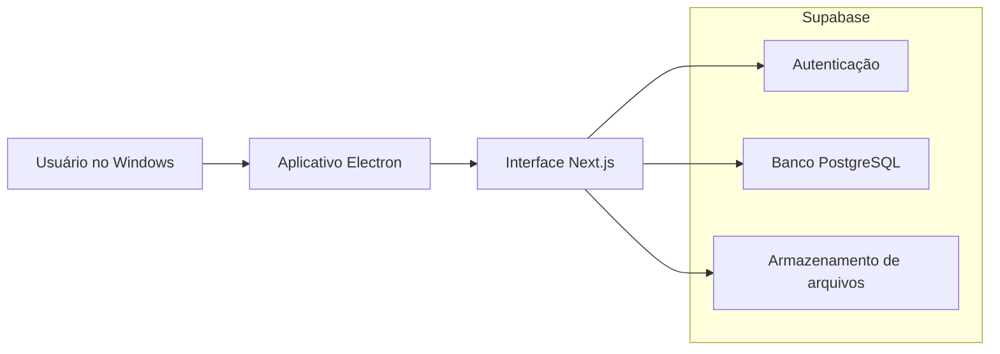

# StockFlow

O StockFlow é um sistema desktop que desenvolvi para organizar a operação de uma pequena loja. Ele reúne frente de caixa, produtos, estoque, clientes, fiado, trocas, inventário e entrada de NF-e no mesmo aplicativo Windows.

Este repositório serve apenas para apresentar o projeto no meu portfólio. O código-fonte, o instalador, as configurações do banco e os dados da loja ficam em um repositório privado. As imagens desta página usam campos vazios ou textos de exemplo.

## O que o sistema faz

- abre e fecha o caixa de cada dia;
- registra vendas com mais de uma forma de pagamento, desconto e troco;
- controla produtos vendidos por unidade ou de forma fracionada;
- importa produtos e custos a partir de XML de NF-e;
- calcula margem de lucro e permite alterar a meta em lote;
- registra clientes, compras, fiado e pagamentos;
- acompanha trocas, devoluções, inventário e movimentações de estoque;
- separa o acesso do administrador e do operador de caixa;
- gera instalador e versão portátil para Windows.

## Tecnologias que usei

| Parte | Tecnologia |
|---|---|
| Aplicativo desktop | Electron 43 |
| Interface | Next.js 16, React 19 e TypeScript 5 |
| Banco e autenticação | Supabase e PostgreSQL 17 |
| Validação | Zod |
| Estado local | Zustand |
| Animações | Framer Motion |
| Gráficos | Recharts |
| Testes | Vitest, Testing Library e Playwright |
| Empacotamento | electron-builder |

## Como organizei a arquitetura

O Electron abre a aplicação em uma janela desktop, enquanto o Next.js monta as telas e trata as ações do usuário. O Supabase fica responsável pelas contas, permissões e dados. As operações que alteram venda ou estoque são concluídas em transações para evitar registros pela metade.

Deixei uma explicação mais completa em [docs/architecture.md](docs/architecture.md) e outros desenhos em [docs/diagrams.md](docs/diagrams.md).

## Alguns números do projeto

Os números abaixo pertencem ao baseline interno da versão 1.0.25.

| Item | Resultado |
|---|---:|
| Arquivos TypeScript e TSX | 209 |
| Linhas TypeScript e TSX sem testes | cerca de 26,8 mil |
| Server Actions exportadas | 61 |
| Telas no App Router | 16 |
| Testes Vitest | 472 em 57 arquivos |
| Cenários Playwright | 19 |
| Rotas autenticadas no smoke do Electron | 12 |
| Configurações da matriz visual | 5 |
| Migrations aplicadas | 14 |
| Vulnerabilidades conhecidas no `npm audit` | 0 |
| Commits verificados no QA com Gitleaks | 223 |

## Telas

Capturei as telas abaixo no aplicativo desktop da versão 1.0.25. Os estados vazios e os dados demonstrativos evitam expor informações da loja.

| Dashboard | PDV com caixa fechado |
|---|---|
|  |  |

| Catálogo | Precificação e margens |
|---|---|
|  |  |

| Entrada por NF-e | Inventário e movimentações |
|---|---|
|  |  |

| Clientes | Fiados |
|---|---|
|  |  |

| Histórico de vendas | Trocas e devoluções |
|---|---|
|  |  |

| Perfil | Configurações da loja |
|---|---|
|  |  |

### Componente em temas e tamanhos diferentes

| Tema escuro | Tema claro |
|---|---|
|  |  |

| Janela compacta | Tela ampla |
|---|---|
|  |  |

A pasta [screenshots](screenshots/) também contém a validação em escala de 150% e a folha de identidade visual.

## Decisões que tomei durante o projeto

- Mantive preço, estoque e pagamentos validados no banco, sem depender apenas da interface.
- Usei transações para as operações que alteram vários registros.
- Criei componentes compartilhados para botões, formulários, alertas e modais.
- Adicionei tema claro e escuro, navegação por teclado, controle de foco e movimento reduzido.
- Separei as permissões por papel e mantive as verificações no servidor e no banco.
- Empacotei o Next.js junto com o Electron para entregar uma experiência de aplicativo Windows.

## Testes

Na versão 1.0.25, o projeto passou por lint, TypeScript, build, testes unitários, testes de componentes e cenários no Playwright. Também testei as rotas autenticadas dentro do Electron e conferi a interface em resoluções, escalas e temas diferentes.

O resumo está em [docs/quality.md](docs/quality.md). Os detalhes operacionais e as evidências completas continuam no repositório privado.

## Documentação

- [Arquitetura](docs/architecture.md)
- [Diagramas](docs/diagrams.md)
- [Interface e design system](docs/design-system.md)
- [Qualidade e testes](docs/quality.md)
- [Decisão de segurança](docs/security.md)

## Sobre este repositório

Não há código executável, credenciais, migrations, instaladores ou dados reais aqui. O material foi separado para mostrar o processo e as decisões técnicas sem expor a operação da loja.

O projeto é proprietário. As imagens, a marca e a documentação não possuem licença de reutilização.
