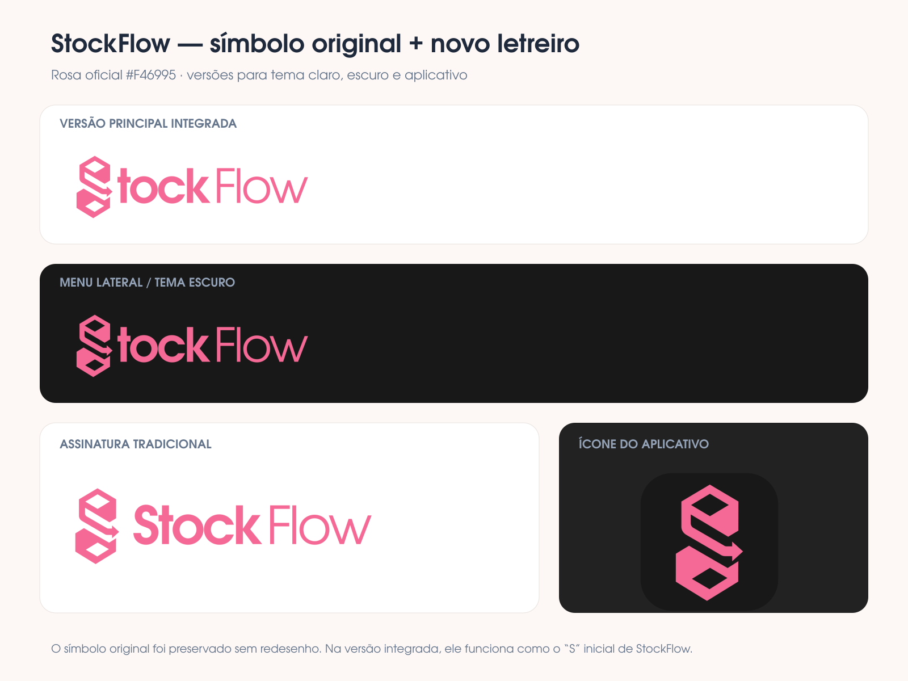

# Interface e design system

## Visual

Usei uma interface compacta porque o sistema mostra bastante informação em tabelas, cards e formulários. O tema escuro é o padrão, e o rosa identifica as ações principais.

O tema claro usa os mesmos componentes. Isso ajudou a conferir se contraste, bordas e hierarquia continuavam legíveis nas duas versões.

## Fontes e movimento

Manrope é a fonte principal. Geist Mono aparece em códigos, identificadores e alguns valores numéricos.

As transições são feitas com Framer Motion. Mantive deslocamentos pequenos e mudanças de opacidade para não atrapalhar o trabalho no caixa. O sistema também respeita `prefers-reduced-motion`.

## Componentes compartilhados

- botões com variações principal, secundária e destrutiva;
- campos com label, ajuda e mensagem de erro;
- alertas de erro, aviso, informação e sucesso;
- modais com cabeçalho, corpo e rodapé;
- caixas de confirmação feitas dentro do próprio sistema;
- estados vazios e mensagens rápidas.

Os modais prendem o foco enquanto estão abertos, fecham com `Escape` e devolvem o foco ao botão anterior. Em telas pequenas, os formulários passam de duas colunas para uma.

## Cuidados que adotei

- valores financeiros ficam alinhados à direita;
- botões não mudam de posição durante o carregamento;
- erros não exibem mensagens cruas do banco;
- ações em andamento ficam bloqueadas para evitar clique repetido;
- elementos decorativos não podem receber o clique no lugar de um botão;
- estados vazios explicam qual é o próximo passo.

## Identidade visual

O símbolo original foi mantido e recebeu versões para fundo claro, fundo escuro, menu lateral e ícone do aplicativo.
