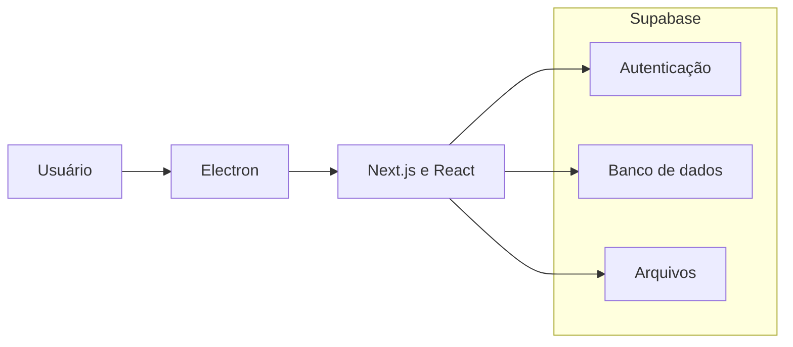
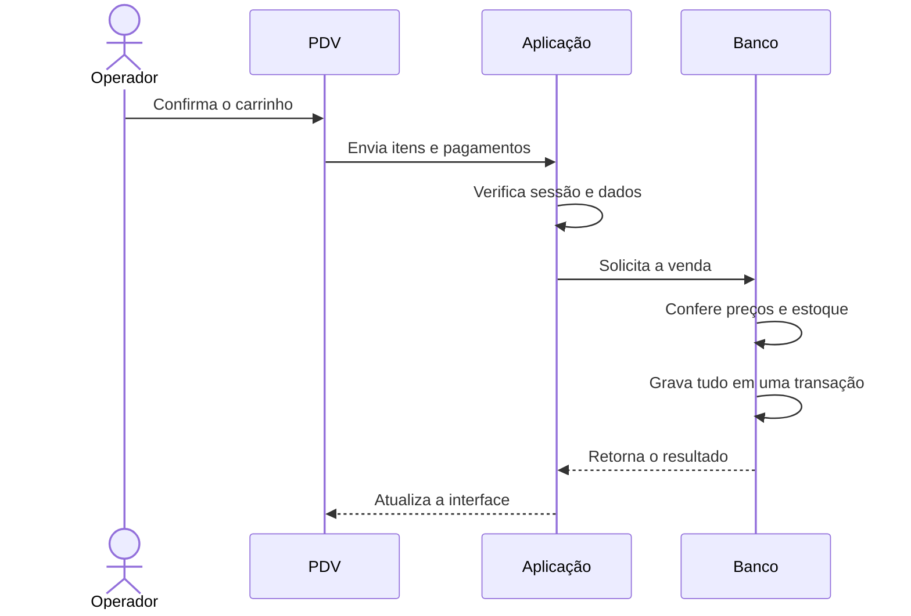
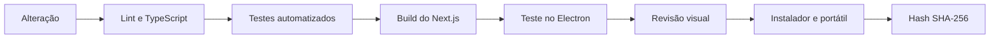

# Diagramas

## Partes principais

O Electron entrega a aplicação como programa Windows. O Next.js monta as telas, e o Supabase mantém as contas e os dados.

## Registro de uma venda

A venda só é concluída depois que o banco confere os valores e o estoque. Os registros relacionados são gravados juntos.

## Testes e entrega

Os testes que podem alterar dados são separados dos testes de leitura. O instalador só é gerado depois das verificações do código e da interface.
